# Awesome Endpoint Data Loss Prevention (DLP) 🛡️

  

  
  
  
  
  
  

---

## 🧭 Curated Directory of Endpoint DLP, PII Redaction & Data Exfiltration Defense

A curated list of **top SaaS platforms** and **open-source GitHub projects** dedicated to **Endpoint Data Loss Prevention (DLP)**, sensitive data discovery, automated PII/PHI redaction, secret scanning, and pre-cloud egress guardrails.

Whether you are an enterprise CISO evaluating DLP solutions with 1,800+ prebuilt classifiers, or an engineer deploying lightweight, self-hosted DLP gates to prevent shadow AI and LLM credential leakage, this repository provides deep architectural comparisons, pricing clarity, and direct links to active tools.

---

## 📑 Table of Contents
- [📊 Sector Overview & Market Dynamics](#-sector-overview--market-dynamics)
- [🏢 Enterprise SaaS / Hosted Platforms](#-enterprise-saas--hosted-platforms)
- [💻 Open-Source GitHub Projects](#-open-source-github-projects)
- [📈 Star History](#-star-history)
- [🤝 How to Contribute](#-how-to-contribute)
- [💖 Support & Sponsorship](#-support--sponsorship)
- [⚠️ Disclaimer](#️-disclaimer)

---

## 📊 Sector Overview & Market Dynamics

The global Data Loss Prevention (DLP) market is estimated at **$3.4B–$4.2B in 2025–2026** (expanding beyond $30B+ when including broader integrated SSE/SASE platforms), with the endpoint DLP segment experiencing rapid ~23% CAGR driven by hybrid work, BYOD risks, and shadow AI usage. 

The sector exhibits **moderate-to-high market concentration**, dominated by tier-1 hyperscalers and cybersecurity conglomerates (where Microsoft Purview alone captures over 20% share alongside Broadcom, Proofpoint, and Trellix accounting for nearly 60% of the market), while agile innovators (e.g., Nightfall AI) and open-source DLP engines (e.g., onprem-dlp, Zero-Leak-DLP) contest specialized AI egress and self-hosted niches.

---

## 🏢 Enterprise SaaS / Hosted Platforms

| Product | Company Scale (Valuation / Revenue) | Description | Pricing (Starting) | Free Tier / Trial Limits |
|:---|:---|:---|:---|:---|
| **[Microsoft Purview DLP](https://www.microsoft.com/en-us/security/business/microsoft-purview)** | **~$3.89T** Market Cap (Microsoft) | 🪟 Integrated DLP across Microsoft 365, endpoints, and cloud apps. Native Windows kernel/OS-level telemetry with prebuilt regulatory templates. Content-blind outside M365 without additional connectors. | **$12.00/user/month** (annual, add-on to M365 E3; or bundled in M365 E5 at $60.00/user/month) | **90-day free trial** (up to 25 Purview Suite trial licenses for M365 E3 tenants; one 30-day extension allowed) |
| **[Symantec DLP](https://www.broadcom.com/)** | **~$1.65T** Market Cap (Broadcom) | 🔒 Enterprise DLP with comprehensive endpoint agent coverage (USB, print, network, clipboard) and mature incident attribution. Highly customizable for complex regulatory environments. | **$1.99/user/year** (starting per seat, volume-dependent) | **90-day proof of concept (POC)** available via Broadcom partner/support request; no permanent free tier |
| **[Zscaler Data Protection](https://www.zscaler.com/)** | **~$31.5B** Market Cap | ☁️ Unified DLP across endpoints, web, and cloud apps integrated within the Zscaler Zero Trust Exchange. Automated classification and inline TLS/SSL inspection. | **$39.89/user/year** (starting baseline for GovCloud/Enterprise per seat) | **30-day proof of concept (POC)** available via enterprise evaluation agreement; no permanent free tier |
| **[Proofpoint DLP](https://www.proofpoint.com/)** | **$12.3B** Valuation (Acquired by Thoma Bravo; ~$2.45B ARR) | ✉️ People-centric DLP and insider threat management. Correlates user behavior, sensitive data movement, and email exfiltration with automated remediation workflows. | **$667.31/user/year** (Enterprise Service Edition tier, 1–500 users) | **30-day free trial** (or structured 14-day rapid evaluation POC with threat assessment report); no permanent free tier |
| **[Netskope DLP](https://www.netskope.com/)** | **~$9.1B** Market Cap (NASDAQ: NTSK) | 🌐 Cloud-native endpoint and SASE DLP powered by Netskope One. Inspects data in motion and at rest across SaaS, IaaS, web, and private apps with 3,000+ data identifiers. | **$50.00/user/year** (~$4.17/user/month for entry Standard DLP bundles) | **30-day proof of concept (POC)** (or 14-day self-paced test drive for select modules); no permanent free tier |
| **[McAfee DLP](https://www.mcafee.com/)** | **~$5.2B** Merged Value (~$1.1B Revenue; STG / Trellix) | 🛡️ Now Trellix DLP. Endpoint and network monitoring suite featuring centralized incident management, device rule enforcement, and unified policies via ePO. | **$45.00/user/year** (starting baseline quote per seat) | **90-day free trial** (for McAfee/Trellix Endpoint DLP evaluation via ePO console); no permanent free tier |
| **[Forcepoint DLP](https://www.forcepoint.com/)** | **~$2.45B** Valuation (Francisco Partners; G2CI unit spun to TPG) | 🎯 Unified DLP across endpoint, network, email, and cloud. Includes 1,800+ prebuilt regional compliance classifiers, Risk-Adaptive Protection, and Generative AI monitoring. | **$50.00/user/year** (~$4.17/user/month entry-tier compliance bundle) | **30-day full-access trial** (evaluation portal with full policy features enabled); no permanent free tier |
| **[Digital Guardian](https://www.digitalguardian.com/)** | **~$800M** Revenue (Fortra) | 🖥️ Deep endpoint visibility agent for Windows, macOS, and Linux. Kernel-level event monitoring, automated tag-based classification, and insider risk detection. | **$15.00/user/year** (approx. $1.25/user/month, minimum 1,000-seat threshold) | **30-day proof of concept (POC)** (guided 2–4 week evaluation arranged with sales); no permanent free tier |
| **[Nightfall AI](https://www.nightfall.ai/)** | **~$60.3M** Funding Raised | 🤖 AI-native DLP utilizing transformer-based detectors (over 95% precision) to discover and prevent PII/secret exfiltration across endpoints, SaaS apps, and GenAI prompts. | **$58.00/user/year** (~$4.83/user/month for SaaS/Cloud baseline; endpoints at $140.00/user/year) | **7-day proof of value trial** (with complimentary security risk assessment) plus **Free developer API tier** (scans up to 3 GB/month free) |

---

## 💻 Open-Source GitHub Projects

Curated community-driven repositories for self-hosted data loss prevention, automated PII redaction, secret scanning, and LLM guardrails—sorted by GitHub stargazers count in descending order.

| Project | GitHub_Stars | Focus & Description |
|:---|:---:|:---|
| **[OpenMetadata](https://github.com/open-metadata/OpenMetadata)** |  | 🏛️ **Unified Data Governance & Discovery Engine.** Open-source platform featuring end-to-end metadata management, data lineage, automated PII auto-classification, and data governance policies across distributed databases and cloud warehouses. |
| **[Presidio](https://github.com/data-privacy-stack/presidio)** |  | 🔍 **PII Detection & Anonymization Framework.** Microsoft's mature framework for context-aware Personally Identifiable Information (PII) detection, redaction, and de-identification in text and images using modular NER models and custom regex recognizers. |
| **[Guardrails](https://github.com/guardrails-ai/guardrails)** |  | 🛡️ **AI Safety, PII & Egress Guardrail Framework.** Open-source validation engine for LLM inputs and outputs. Validates structured responses, scrubs sensitive data, blocks toxic or leaking prompts, and enforces strict security policies at inference time. |
| **[detect-secrets](https://github.com/Yelp/detect-secrets)** |  | 🔑 **Enterprise Secret Scanner & Pre-Commit Gate.** Yelp's battle-tested heuristics-based secrets detection baseline tool designed to prevent API keys, private certificates, and authentication tokens from escaping endpoint developer environments into repositories. |
| **[Bearer](https://github.com/Bearer/bearer)** |  | 🔎 **Data Security & Privacy Code Scanner.** Static application security testing (SAST) tool purpose-built to discover sensitive data flows, PII disclosures, and missing encryption controls across codebases before deployment. |
| **[ThinkWatch](https://github.com/ThinkWatchProject/ThinkWatch)** |  | 🌐 **Self-Hosted AI & MCP Security Gateway.** Reverse proxy and DLP firewall for AI applications with single sign-on (SSO), per-user identity for MCP tool calls, real-time PII redaction, rate limits, and tamper-resistant audit logs. |
| **[privacy-filter](https://github.com/packyme/privacy-filter)** |  | ⚡ **High-Speed LLM Privacy Gateway.** Written in Go with sub-millisecond execution to intercept LLM prompts, scrub secrets, and sanitize PII in real-time before cloud transmission. |
| **[pii-redaction](https://github.com/OpenPipe/pii-redaction)** |  | ✂️ **Local SOTA PII Redaction Engine.** Lightweight, fast library by OpenPipe to locate and sanitize personal information on edge devices without requiring network calls or cloud dependencies. |
| **[phileas](https://github.com/philterd/phileas)** |  | 🏥 **Clinical PII & PHI De-Identification Engine.** Open-source redaction system tailored specifically for HIPAA compliance, electronic health records (EHR), and sensitive healthcare data streams. |
| **[onprem-dlp](https://github.com/portable-genai/onprem-dlp)** |  | ⚙️ **Deterministic Pre-Cloud DLP Gate.** CPU-only, Apache-2.0 solution operating entirely on-premise. Features structured and unstructured PII classification with strict ALLOW/REDACT/BLOCK decision flows and checksum validators. |
| **[Zero-Leak-DLP](https://github.com/AAH20/zero-leak-dlp)** |  | 🧩 **Zero-Dependency AI Exfiltration Shield.** 100% Python Standard Library execution (<0.02ms) with recursive payload unpacking, entropy scanning, and cryptographic SHA-256 AuditLedger for ISO 42001 and SOC 2 Type II compliance. |

---

## 📈 Star History

---

## 🤝 How to Contribute

Contributions are warmly welcome! Help make the Endpoint DLP ecosystem more comprehensive, open, and transparent.

1. 🍴 Fork the repository.
2. 🌿 Create a feature branch: `git checkout -b feature/new-dlp-tool`.
3. 📝 Add your entry to [README.md](file:///C:/Users/ishan/Documents/Projects/Awesome-Endpoint-Data-Loss-Prevention-DLP/README.md) following the existing table schema.
4. 🚀 Submit a Pull Request with a clear summary of the tool, license, and pricing transparency.

---

## 💖 Support & Sponsorship

If you found this curated DLP guide helpful for your security stack, architecture decisions, or compliance roadmap:

- ⭐ **Star this repository** to help others discover it!
- 🍴 **Fork and share** with fellow security engineers and privacy practitioners.
- ☕ **Buy a coffee & sponsor**: Consider supporting ongoing maintenance via the [GitHub Sponsor Dashboard](https://github.com/sponsors/ishandutta2007). Your support helps keep these benchmarks and ecosystem maps actively updated!

---

## ⚠️ Disclaimer

- This repository is a **community-curated index** provided for educational and architectural evaluation purposes—it does not constitute formal legal or compliance certification.
- Endpoint DLP platforms handle mission-critical, confidential assets including PII, PHI, financial records, and credentials. Always enforce strict least-privilege permissions, continuous telemetry audits, and data protection regulations (GDPR, HIPAA, PCI-DSS) in staging before production deployment.
- **Always independently verify pricing and detection precision on your organization's specific data types.** Commercial DLP quotes fluctuate based on seat count, bundled CASB/SSE modules, and deployment architectures.

---

  <b>Built with care for security architects, data protection officers, and engineering teams securing data in motion and at rest.</b>

